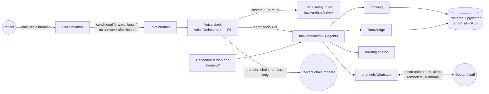

# Architecture

Technical design for Catalyst. Read `CLAUDE.md` and `context/mvp.md` first. Interfaces and schemas are in `context/contracts.md`; decisions are in `context/decisions.md`.

> No application code exists yet. This is the target design, to be corrected against reality as it's built.

**Tags:** every component is marked **[MVP]** (needed for the clinic pilot) or **[Post-MVP]** (designed for, not built now). Don't build Post-MVP pieces unless the team decides to (see `CLAUDE.md` working agreement).

---

## 1. System overview [MVP]

Our backend owns the brain; the voice stack only talks (ADR-0032).



- **Voice layer.** This is a managed platform or self-hosted Pipecat, behind `VoiceOrchestrator` (D1 / ADR-0029, Proposed). It handles audio, turn-taking, barge-in and transfer, and it calls our nine tools (`contracts.md` §1).
- **Backend** (Python 3.12 + FastAPI, `backend/src/`). It holds the knowledge, schedule, rules, safety decisions, alerts and the transcript store.
- **WhatsApp.** This is its own module, with preview-and-confirm on every write (ADR-0034).
- **Receptionist web app.** It uses the same backend API as everything else.

---

## 2. Agent tools API and call flow [MVP]

The nine tools are `get_clinic_info`, `find_slots`, `book`, `reschedule`, `cancel`, `create_callback`, `escalate`, `transfer` and `log_call_outcome`. Their contracts are in `contracts.md` §1. HTTP routes live in `backend/src/api/` and handlers in `backend/src/agents/`.

A typical booking call runs like this:

1. Disclose that the caller is talking to the automated assistant.
2. Understand the request.
3. Call `find_slots` and offer 2–3 options.
4. Read back the day, date, time and doctor.
5. Call `book`.
6. Confirm.
7. Call `log_call_outcome`.

**Failure path.** On any tool error or backend outage, take the caller's name and number and call `create_callback(urgent)`. If that also fails, play the platform's fallback message. The caller never hears dead air (C6).

---

## 3. Safety [MVP]

Two pieces, both in `backend/src/safety/`, both in code (not just prompt):

1. **Guard layer.** Every LLM reply on a clinic call is checked before it is spoken.
   - Any diagnosis, medicine or dosage advice is blocked. The guard replaces it with a safe line and escalates as `grey_zone`.
   - With a managed platform, this runs via our custom-LLM endpoint (`contracts.md` §2). VERIFY that the chosen platform supports it. A platform that can't is not acceptable for healthcare.
2. **Red-flag engine.** It matches caller turns against `verticals/<name>/escalation-rules.yaml`:
   - routine reasons book;
   - red flags and grey-zone calls escalate;
   - after hours, the agent gives the approved emergency instruction.

   This is ADR-0031 (Proposed); it replaces the old "any symptom escalates" rule.

**Global uncertainty rule.** If no approved answer exists, the agent says so, takes name and number, and logs a **callback**, not an escalation (C3).

**Safety suite.** 50+ scripted calls in `verticals/clinic/tests/` must pass at 100% before go-live and after every prompt or rule change. This is the M3 go-live gate.

---

## 4. Booking model [MVP]

The model is generic: resources, services, availability rules, blocks and bookings (ADR-0033). The schema is in `contracts.md` §3.

- Every booking has a `source`: `phone`, `whatsapp` or `walk_in`.
- A Postgres exclusion constraint on `(tenant_id, resource_id, time range)` makes overlapping active bookings impossible from any channel.
- Cancelling or moving a booking frees the slot immediately.
- No table or column is named after a clinic-only concept.

---

## 5. Verticals are config [MVP]

A vertical is a folder, `verticals/<name>/`, containing:

| File | What it holds |
|---|---|
| `vertical.yaml` | labels such as "Doctor", booking rules, enabled WhatsApp commands, language defaults, alert settings |
| `agent-prompt.md` | the prompt, versioned |
| `escalation-rules.yaml` | the red-flag list, grey-zone handling and the after-hours instruction |
| `onboarding-questions.md` | questions to ask a new client |
| `seed-knowledge.yaml` | starting answers, approved before go-live |
| `tests/` | safety-suite scripts and fixtures |

`backend/src/verticals/` loads and validates this config, and nothing else. **Core code never branches on vertical.** The `demo_coaching` fixture in `backend/tests/fixtures/verticals/` must load without core changes (MVP done-criterion). To start a new vertical, copy `verticals/_template/`.

---

## 6. WhatsApp channel [MVP]

`backend/src/channels/whatsapp/` covers four things. Formats are in `contracts.md` §4–5.

- **Doctor commands.** Text → LLM extraction (Pydantic, fails closed) → preview → apply only on "Haan" → reply "live" (ADR-0017, ADR-0034). If the parser is unsure, it goes to manual handling by our team the same day.
- **Alerts.** Urgent escalation and callback alerts repeat to the backup chain until marked done.
- **Weekly summary** to the owner.
- **Patient reminders and opt-out** (STOP). These are service messages only.

Only numbers registered to the tenant (`whatsapp_senders`) can give commands. Messages are paid utility templates (D5).

---

## 7. Telephony [MVP]

The call path is: clinic number → conditional forward (busy / no answer / after hours) → pilot number → voice stack.

- **Transfers and failover go only to separate mobile numbers in the contact chain.** They never go back to the forwarding clinic number, because under conditional forwarding that number is busy or unanswered and the call would loop.
- Setup validation rejects a chain that contains a forwarding number.
- Pilot mode is missed and after-hours calls only.
- The number and provider are decided by D2 / ADR-0030 (Proposed) and spike S1.

`TelephonyProvider` sits behind `backend/src/providers/telephony/`. WebRTC stays available for dev and demos (ADR-0005).

---

## 8. Provider abstraction layer [MVP]

Every voice, STT, TTS, LLM and telephony vendor sits behind our own interface in `backend/src/providers/`. **No vendor SDK is imported outside that directory** (ADR-0014). Switching the voice stack never touches business logic.

```python
# backend/src/providers/voice_orchestrator/base.py
class VoiceOrchestrator(Protocol):
    async def start_session(self, call_handle: CallHandle, *, agent_config: AgentConfig) -> VoiceSession: ...
    async def end_session(self, session: VoiceSession) -> CallSummary: ...
    # concrete: managed platform (pilot, if ADR-0029 accepted), PipecatOrchestrator (long-term)

# backend/src/providers/telephony/base.py
class TelephonyProvider(Protocol):
    async def answer_inbound_call(self, call_sid: str) -> CallHandle: ...
    async def transfer(self, call_handle: CallHandle, destination: str, *, ring_seconds: int) -> TransferResult: ...
    async def end_call(self, call_handle: CallHandle) -> None: ...
    # place_outbound_call exists only behind the DLT gate [Post-MVP], §12

# backend/src/providers/stt/base.py
class SpeechToText(Protocol):
    async def transcribe_stream(self, audio: AsyncIterator[bytes], *, language: str) -> AsyncIterator[TranscriptChunk]: ...

# backend/src/providers/tts/base.py
class TextToSpeech(Protocol):
    async def synthesize_stream(self, text: str, *, language: str, voice: str) -> AsyncIterator[bytes]: ...

# backend/src/providers/llm/base.py
class LLMProvider(Protocol):
    async def complete(self, messages: list[Message], *, tools: list[Tool] | None = None) -> LLMResponse: ...
    async def embed(self, text: str) -> list[float]: ...
```

STT and TTS interfaces matter only if the pilot stays on Pipecat, or after the move back to it. A managed platform brings its own STT and TTS. Every implementation passes a shared contract test per interface.

---

## 9. Data, privacy and retention [MVP]

- **Minimum patient data:** name, phone, slot, and an optional non-clinical reason for the visit.
- **Multi-tenancy:** `tenant_id` plus RLS on every tenant table from its first migration (ADR-0016). The RLS session variable is set once per request.
- **No PII in logs.** Log IDs only.
- **Transcripts** live in our Postgres. **Recordings** are kept only after the caller has been told.
- **Deletion** requests are handled manually by ops in the MVP. Tooling for it is Phase 2 item 87.
- **Residency.** The rule is that personal data stays on India-region infra. Hosted STT, LLM and voice vendors may process it abroad, and the residency decision is open: see ADR-0029 and D3. The DPDP consent notice is reviewed with our mentor before go-live.

---

## 10. Scheduled jobs and health alerts [MVP]

The jobs are: reminders, the weekly summary, repeating urgent alerts, and ops health checks (forwarding broken, weekday silence, reminder failures). `backend/src/workers/` holds them. The scheduler is decided by D7 (Celery beat or something lighter).

---

## 11. Deployment and latency [MVP — numbers open]

- **Shape:** one Docker Compose stack (Postgres + pgvector, backend, workers, Caddy) on a single India-region VM. The Oracle Always Free plan is ADR-0003.
- **RAM is disputed** (D3): 12 GB or 24 GB. If D1 goes managed, the VM no longer runs speech models, so the old budget below shrinks a lot. Re-check it on the team's own account.
- **Latency target:** under ~1 s (C2). ADR-0015 accepted 1.2–2 s for the self-hosted CPU stack. This is linked to D1, and spike S3 measures the real number.

Old self-hosted estimate, kept for reference (Pipecat path):

| Stage | Estimate |
|---|---|
| VAD / turn end | 100–200 ms |
| STT (Groq / faster-whisper fallback) | 200–400 / 400–700 ms |
| Retrieval | 20–50 ms |
| LLM (Groq / Cerebras) | 150–400 ms |
| TTS (Kokoro / Piper, CPU) | 300–600 ms |
| Playback | 100–200 ms |
| **Total** | **~1.2–2.0 s** |

Old RAM estimate for the Pipecat path, against 24 GB: about 13.1 GB across Caddy, the app, the Pipecat worker, faster-whisper, Kokoro/Piper, Postgres, Redis, Celery and Langfuse. Redo it for D3.

**ARM:** if the Oracle ARM VM is used, every image needs an arm64 build. Verify ML wheels before relying on them.

---

## 12. Post-MVP components

These are designed for but not built for the pilot.

- **Outbound calls and SMS [Post-MVP].** This is everything that places a call or sends an SMS: item 44 reminder calls, lead follow-up.
  - It ships behind a **fail-closed TRAI DLT gate** (ADR-0019). The default with no confirmed registration record is block, never allow.
  - Separately enforced: the 9 AM–9 PM IST window, checked at dispatch time; DND scrub (`dnd_list`); and consent (`consent_records`).
  - The gate lives in `backend/src/compliance/`.
  - MVP WhatsApp reminders are *messages*, not calls, and are not part of this path. They still respect STOP and are service-only.
- **Cost tiers [Post-MVP].** `agent_configs.cost_tier` (`free`, `standard`, `premium`) resolves providers per tenant via a `ProviderFactory`. The pilot runs one configuration, so tiers beyond the pilot wait.
- **Separate inbound and outbound agent configs [Post-MVP]** (ADR-0018).
- **Observability [Post-MVP].** Langfuse (self-hosted) traces with per-call cost, Sentry and PostHog. In the MVP, rely on structured, PII-free logs and the `calls` table.
- **Call audio in Cloudflare R2 [Post-MVP]**, with a 30-day lifecycle and a 10 GB free ceiling (ADR-0012). R2 residency is open (ADR-0029).
- **Free-tier guardrails [Post-MVP, pilot-dependent].** This means 429 detection, a circuit breaker and failover to self-hosted STT. It matters only on the Pipecat + free-tier path.
- **Separate staging environment [Post-MVP].** For now there is one environment.

---

## See also

- `context/contracts.md`: tools API, schema, WhatsApp and alert formats.
- `context/decisions.md`: ADRs, Proposed ADRs, and D1–D7.
- `context/coding-rules.md`: how to implement all of this.
- `open-source/open-source.md`: licences and free-tier ceilings.
